<p align="center">
  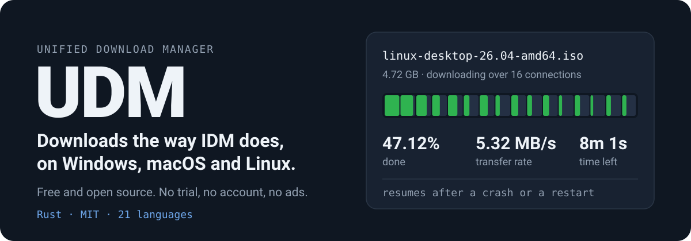
</p>

<p align="center">
  <a href="https://github.com/tajbinkhan/UDM/releases/latest"></a>
  <a href="https://github.com/tajbinkhan/UDM/releases/latest"></a>
  <a href="https://github.com/tajbinkhan/UDM/releases/latest"></a>
</p>

<p align="center">
  UDM (Unified Download Manager) is a download manager and video downloader written in Rust.<br>
  It splits each file over up to 16 connections, resumes after interruptions,<br>
  and catches downloads from Chrome, Edge, Brave, Vivaldi, Opera, Firefox and Safari.<br>
  <a href="https://tajbinkhan.github.io/UDM/">tajbinkhan.github.io/UDM</a>
</p>

<p align="center">
  <a href="docs/images/main-light.webp">
    <picture>
      <source media="(prefers-color-scheme: dark)" srcset="docs/images/main-dark.webp">
      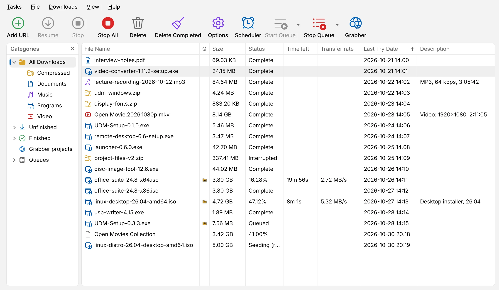
    </picture>
  </a>
</p>

<p align="center">
  <a href="https://github.com/tajbinkhan/UDM/releases/latest"></a>
  <a href="https://github.com/tajbinkhan/UDM/releases"></a>
  <a href="https://github.com/tajbinkhan/UDM/actions/workflows/build.yml"></a>
  <a href="https://github.com/tajbinkhan/UDM/stargazers"></a>
  <a href="LICENSE"></a>
</p>

<p align="center">
  Windows 10 and 11 · macOS 11 or later (Apple Silicon and Intel, experimental) · Linux (Ubuntu, Debian, Mint, Fedora, openSUSE and more)<br>
  21 languages, Hebrew, Arabic and Persian laid out right to left · no ads, no trial, no sign-up
</p>

<p align="center">
  <a href="#download"><b>Download</b></a> ·
  <a href="#why-switch-from-idm"><b>Why switch</b></a> ·
  <a href="#screenshots"><b>Screenshots</b></a> ·
  <a href="#what-it-does"><b>What it does</b></a> ·
  <a href="docs/README.md"><b>Help pages</b></a> ·
  <a href="#for-developers"><b>For developers</b></a>
</p>

## Why switch from IDM?

UDM works the way IDM does, runs on every computer you use, and costs nothing.

| | UDM | IDM |
| --- | --- | --- |
| Windows | **Yes** | Yes |
| macOS and Linux | **Yes** | No |
| Price | **Free** | Paid, after a 30-day trial |
| Sign-up or serial number | **None** | Registration needed |
| Open source | **Yes** (MIT) | No |

There is nothing new to learn. The browser hands its downloads over, and a save-as dialog asks
where they go. The categories, queues, scheduler and download windows are where you expect them.
UDM's downloads run in a background program of their own, so they keep going after you close the
browser and the window.

**Faster than IDM in our tests.** UDM 0.4.0 and IDM 6.43 ran on one Windows machine against a
test server that misbehaves on purpose: it drops connections, starts slowly, sends wrong ranges
and limits speed. UDM finished a 64 MiB file sooner than IDM in all eight scenarios. When the
server sent wrong ranges, UDM took 3.3 s and IDM 16.1 s. When the server was slow to answer, UDM
took 4.0 s and IDM 6.3 s. [How it was measured](docs/bench/README.md).

<p align="center">
  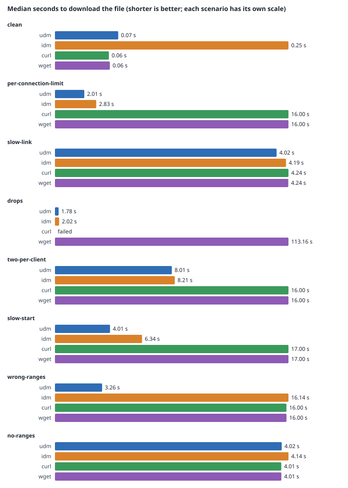
</p>

## Screenshots

<table>
  <tr>
    <td align="center" width="50%"><a href="docs/images/save-as-light.webp"><picture><source media="(prefers-color-scheme: dark)" srcset="docs/images/save-as-dark.webp">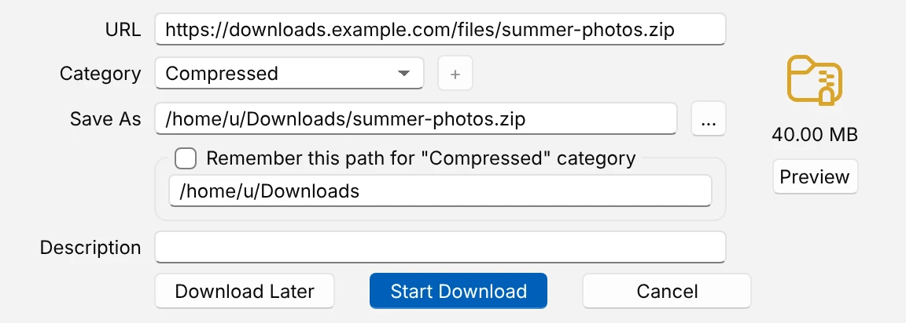</picture></a><br><sub><b>Download File Info</b>: the name, category and folder of a caught download</sub></td>
    <td align="center" width="50%"><a href="docs/images/download-light.webp"><picture><source media="(prefers-color-scheme: dark)" srcset="docs/images/download-dark.webp">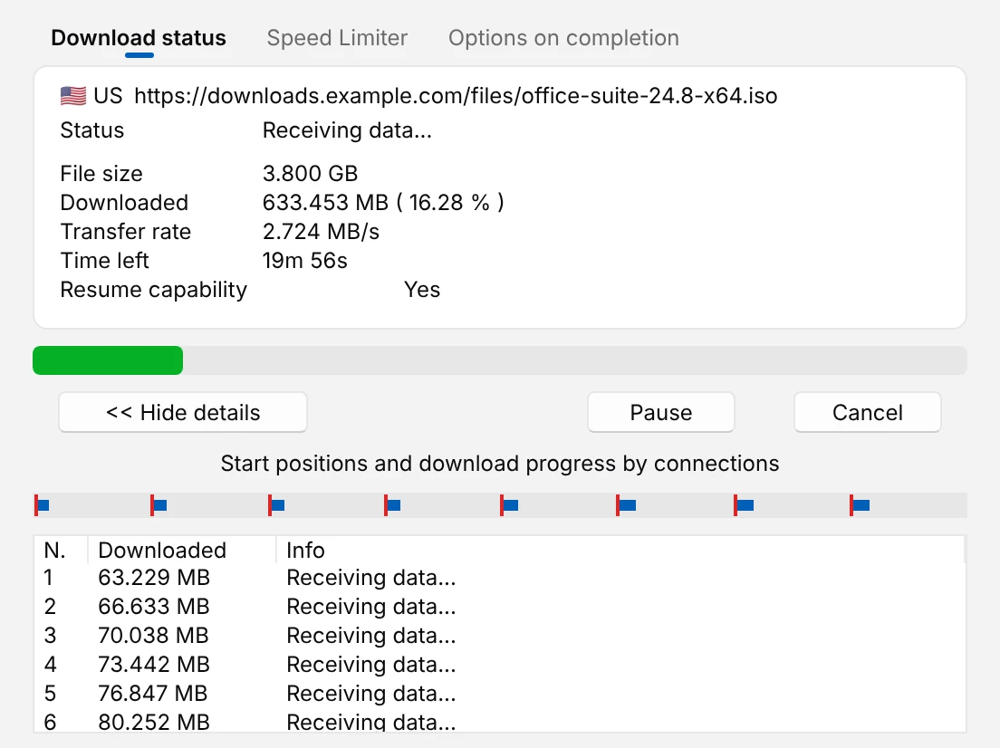</picture></a><br><sub><b>The download window</b>, with its connections at work</sub></td>
  </tr>
  <tr>
    <td align="center" width="50%"><a href="docs/images/video-light.webp"><picture><source media="(prefers-color-scheme: dark)" srcset="docs/images/video-dark.webp">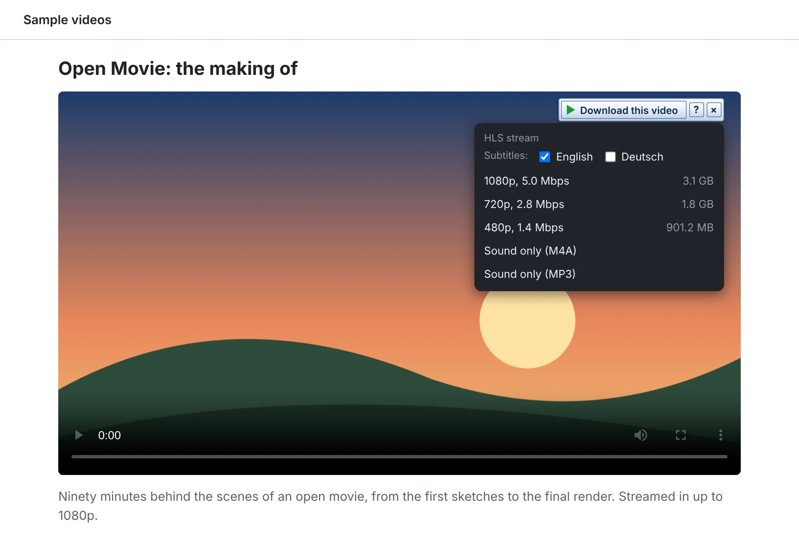</picture></a><br><sub><b>Download this video</b> over a player in the browser, with each quality</sub></td>
    <td align="center" width="50%"><a href="docs/images/torrent-light.webp"><picture><source media="(prefers-color-scheme: dark)" srcset="docs/images/torrent-dark.webp">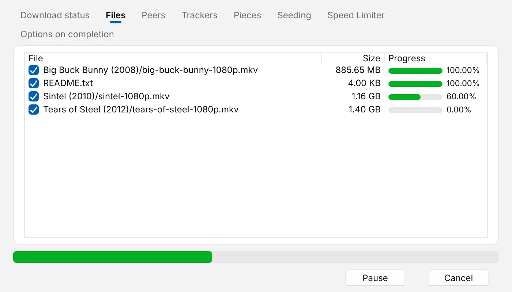</picture></a><br><sub><b>A torrent</b>: tick the files you want, watch each one fill</sub></td>
  </tr>
  <tr>
    <td align="center" width="50%"><a href="docs/images/scheduler-light.webp"><picture><source media="(prefers-color-scheme: dark)" srcset="docs/images/scheduler-dark.webp">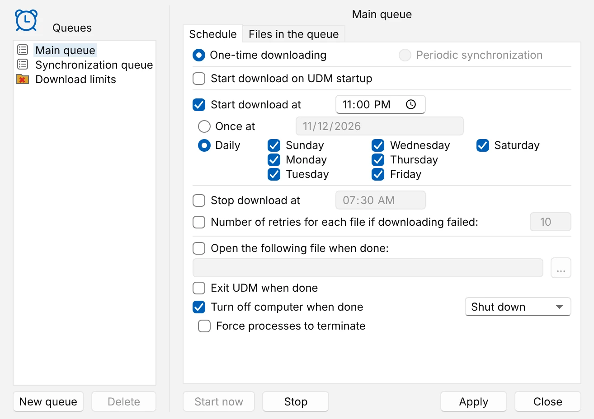</picture></a><br><sub><b>The Scheduler</b>: a queue that starts at 11 PM and shuts down when done</sub></td>
    <td align="center" width="50%"><a href="docs/images/options-light.webp"><picture><source media="(prefers-color-scheme: dark)" srcset="docs/images/options-dark.webp">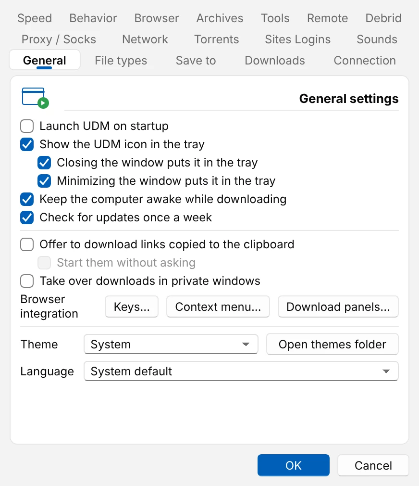</picture></a><br><sub><b>Options</b>, with the settings IDM users know</sub></td>
  </tr>
  <tr>
    <td align="center" colspan="2"><a href="docs/images/linux-light.webp"><picture><source media="(prefers-color-scheme: dark)" srcset="docs/images/linux-dark.webp">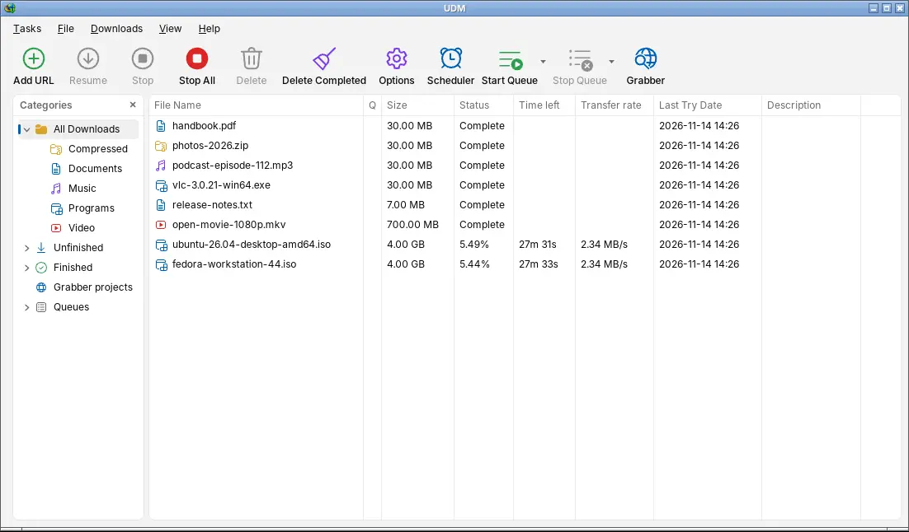</picture></a><br><sub><b>On Linux</b>: the real window, in a plain X11 session</sub></td>
  </tr>
</table>

Light or dark follows your system here, as in UDM. Step by step:
[your first download](docs/guides/first-download.md) ·
[catch browser downloads](docs/guides/catch-browser-downloads.md) ·
[download overnight](docs/guides/download-overnight.md) ·
[a video from a page](docs/guides/video-from-a-page.md) ·
[resume a broken download](docs/guides/resume-a-broken-download.md)

## Download

On the [Releases page](https://github.com/tajbinkhan/UDM/releases/latest), pick one:

| File | Choose it when |
| --- | --- |
| **`UDM-Setup-<version>.exe`** | **On Windows and not sure? Take this one.** It installs for your user only, without administrator rights, and connects UDM to Chrome, Edge and Firefox. |
| `UDM-<version>-windows-portable.zip` | You want to run UDM from a USB stick or without installing it. It keeps everything in its own folder ([portable mode](docs/portable.md)). |
| `UDM-<version>-macos.dmg` | You're on a Mac (Apple Silicon or Intel). **Experimental**, not yet tried on a real Mac. Drag UDM to Applications. |

> [!NOTE]
> UDM isn't code-signed yet. On Windows, SmartScreen may say *"Windows protected your PC"*:
> click **More info**, then **Run anyway**. On a Mac with macOS 15 or later, open UDM once, click
> **Done** when macOS says it can't verify the app, then click **Open Anyway** in **System
> Settings > Privacy & Security**. On macOS 14 and earlier, Control-click UDM in Applications and
> choose **Open**. [Installing on macOS](docs/install.md#macos) has the details.

Then add the browser extension once: [Chrome, Edge, Brave, Vivaldi and Opera](docs/install.md#windows),
[Firefox](docs/install.md#firefox) or [Safari](docs/install.md#safari). On macOS and Linux, UDM
connects itself to every browser it finds the first time it runs.

### On Linux

The Linux files need glibc 2.35, OpenSSL 3 and WebKitGTK 4.1 (Ubuntu 22.04, Debian 12, Fedora 36
or newer). The tray icon needs `libayatana-appindicator3` (and, on GNOME, the AppIndicator
extension).

| File | For |
| --- | --- |
| `udm_<version>_amd64.deb` | Ubuntu, Debian, Mint, Pop!_OS: `sudo apt install ./udm_*.deb`. |
| `udm-<version>-1.x86_64.rpm` | Fedora, openSUSE, RHEL: `sudo dnf install ./udm-*.rpm`. |
| `UDM-<version>-x86_64.AppImage` | Any Linux with WebKitGTK 4.1. Make it executable and run it. |
| `udm-<version>-linux-x86_64.tar.gz` | Any Linux: unpack it and run `./install.sh` (installs into `~/.local`). |

### On a server

`udm-daemon --server` runs the background service without a window, and the Docker image
`ghcr.io/tajbinkhan/udm` packs it with `udm-cli` and `udm-mcp`:

```bash
docker run -d --name udm --restart unless-stopped -v udm-config:/config -v /srv/downloads:/downloads ghcr.io/tajbinkhan/udm:latest
```

[Run UDM on a server](docs/server.md) covers the folders, Compose, Unraid and adding downloads
from a terminal or a phone.

### Videos from YouTube and other sites

To save streamed videos as one `.mp4`, UDM needs [ffmpeg](https://ffmpeg.org/). For YouTube,
Facebook, Instagram, Vimeo, playlists and the other sites it reads, it also needs
[yt-dlp](https://github.com/yt-dlp/yt-dlp), and for image galleries
[gallery-dl](https://github.com/mikf/gallery-dl).

**Options > Tools** installs them. Its buttons download the official builds and check each one
against its published checksum (for ffmpeg, on Windows and Linux) ([more](docs/install.md#windows)).

### Coming from Pullbay or UIDM?

UDM was called Pullbay in version 0.4 and UIDM up to 0.3.3. Install UDM over either one. Your
settings, download list and half-finished downloads move over on the first start
([more](docs/install.md#coming-from-pullbay-or-uidm)).

## What it does

**Downloads faster and finishes them**

- **Up to 16 connections per file.** Each fetches its own part. When the server speaks HTTP/2,
  the parts share one connection as separate streams. HTTP, HTTPS, FTP and FTPS.
- **Resumes** after a crash, a restart or a dropped connection, without starting over. **New
  link** gives an expired download a fresh address and carries on.
- **Keeps going after the browser closes.** A background program owns the downloads; the window
  and the browser only show what it is doing.
- **Torrents and magnet links**: pick a torrent's files, then it seeds until a share ratio or a
  time limit you set ([torrents](docs/torrents.md)).
- **Looks after the finished file.** A notification offers **Open** and **Show in folder**. UDM
  can scan the file with Microsoft Defender or a scanner you choose, verify its checksum, and
  unpack archives, split ones included.

**Catches what the browser finds**

- **Downloads from Chrome, Edge, Brave, Vivaldi, Opera, Firefox and Safari**, with their cookies
  and referrer, so files behind a sign-in work. Downloads started by a form are sent the same
  way. While UDM isn't running, the browser keeps its own downloads.
- **Videos from a button over the player.** HLS, DASH and HDS streams come in the quality you
  pick, with their audio tracks and subtitles, joined into one file with ffmpeg. YouTube,
  Facebook, Instagram and Vimeo pages work through yt-dlp, and image galleries through gallery-dl.
- **Many files at once**: a numbered pattern such as `photo[001-120].jpg`, a pasted list, every
  link on a page or in a selection, or the **site grabber** crawling a site for the files you
  want. UDM can watch the clipboard for links, too.

**Runs on your terms**

- **Downloads overnight** with queues and a scheduler that can wake the computer, then puts it to
  sleep or shuts it down when they're done. A queue can also keep files in sync.
- **Leaves you some speed**: a limit for all downloads, one for a single download, a quota of so
  many MB every so many hours, and an option to lift the limit while nobody uses the computer.
- **Goes where you send it**: the system proxy, PAC and WPAD scripts, HTTP, HTTPS, FTP and SOCKS
  proxies, and site logins. Downloads can be bound to one network adapter, such as a VPN's, and
  stop when it goes down; names can be looked up with DNS over HTTPS ([network](docs/network.md)).
- **File hosts through a debrid account** (experimental): Real-Debrid, AllDebrid or Premiumize
  unlocks links to hosts such as Rapidgator ([debrid](docs/debrid.md)).

**Works from other places**

- **Scripts and terminals.** `udm-gui` takes IDM's command-line switches. `udm-cli` adds, lists
  and controls downloads, with exit codes scripts can test, over a documented, versioned API
  ([how](docs/command-line.md)).
- **AI assistants.** `udm-mcp` is an MCP server, so Claude, Cursor or VS Code can list, add,
  pause, resume and remove downloads and start queues ([setup](docs/ai-assistants.md)).
- **A phone on your home network.** Pair it with a QR code and manage downloads from its browser
  ([remote control](docs/remote-control.md)).

**Fits your screen and your language**

- Light, dark and high-contrast themes, theme files of your own, and an interface from 80 % to
  200 % ([themes](docs/themes.md)). The window reads to screen readers and works from the keyboard
  ([keys](docs/keyboard-shortcuts.md)).
- 21 languages. Hebrew, Arabic and Persian lay the windows out right to left.

In depth: [install](docs/install.md) · [using UDM](docs/using-udm.md) ·
[what the extension takes](docs/browser-capture.md) ·
[videos, batches and the site grabber](docs/streams-batches-and-grabber.md) ·
[queues and the scheduler](docs/queues-and-scheduler.md) · [all help pages](docs/README.md)

## How it fits together

<p align="center">
  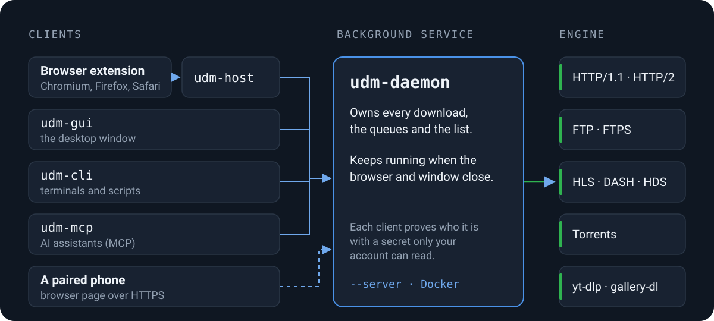
</p>

- **`udm-daemon`** owns the download engine and keeps running on its own, on a desktop or a
  server.
- **`udm-host`** is what the browser starts. It passes the extension's messages to the daemon.
- **`udm-gui`** is the desktop window, **`udm-cli`** the terminal tool and **`udm-mcp`** the
  server for AI assistants. All three are clients of the daemon.

Every client proves who it is to the daemon with a secret that only your user account can read
([how](docs/architecture.md#host-daemon-authentication)). A paired phone reaches it over HTTPS
with a device secret of its own.

<!-- The Help menu and the video button of UDM 0.4.0 and earlier link to these anchors. -->
<a name="use"></a><a name="queues-and-the-scheduler"></a><a name="what-the-extension-does-and-does-not-take"></a><a name="streams-batches-and-the-site-grabber"></a>

## Help pages

| Page | What it covers |
| --- | --- |
| [Install](docs/install.md) | Every system's files, the browser extension, ffmpeg and yt-dlp, updates, uninstalling |
| [Using UDM](docs/using-udm.md) | The window, the save-as dialog, categories, queues, the tray, the download window, Options |
| [Torrents and magnet links](docs/torrents.md) | Adding them, choosing their files, seeding and its limits |
| [Streams, batches and the site grabber](docs/streams-batches-and-grabber.md) | Videos, subtitles, numbered batches, crawling a site |
| [Queues and the scheduler](docs/queues-and-scheduler.md) | Running downloads by the clock, and what happens when they're done |
| [Network](docs/network.md) | One network adapter only, the kill switch, DNS over HTTPS, the server's country |
| [Proxies and logins](docs/proxies-and-logins.md) | Proxies, PAC scripts and site logins |
| [Command line and automation](docs/command-line.md) | IDM's switches, the `udm-cli` tool, sending links from other programs, the automation API |
| [AI assistants (MCP)](docs/ai-assistants.md) | Setting up `udm-mcp` for Claude Desktop, Claude Code, Cursor and VS Code |
| [Remote control from a phone](docs/remote-control.md) | Pairing a phone and how it is protected |
| [Run UDM on a server](docs/server.md) | Server mode, the Docker image, Compose and Unraid |
| [What the extension takes](docs/browser-capture.md) | Which browser downloads go to UDM, and which stay with the browser |
| [Known gaps](docs/known-gaps.md) | What doesn't work yet, or works differently on macOS and Linux |

The full list is in [the help pages](docs/README.md).

## For developers

<details>
<summary><b>Build from source</b></summary>

You need a stable Rust toolchain, Node 22 or newer and pnpm. On Linux, also install WebKitGTK 4.1
and its friends (`sudo apt install libwebkit2gtk-4.1-dev libayatana-appindicator3-dev librsvg2-dev
libssl-dev build-essential` on Ubuntu). The window embeds the built frontend, so build it before
Cargo:

```bash
pnpm --dir frontend install --frozen-lockfile
pnpm --dir frontend build
cargo test --workspace
cargo build --release
```

This puts the programs in `target/release/`: `udm-gui` (the window), `udm-daemon` (the engine),
`udm-host` (the browser's relay), `udm-cli` and `udm-mcp`. On Windows, `.\install-host.ps1` builds
them, connects them to Chrome, Edge and Firefox, and adds UDM to the Start menu.
[Building UDM](docs/building.md) covers packaging for each system, the Windows toolchain and the
quality gates.

</details>

<details>
<summary><b>Layout</b></summary>

A Cargo workspace with one crate per layer of a hexagonal design.
[AGENTS.md](AGENTS.md) holds the rules between them; [Building UDM](docs/building.md#layout)
lists every module.

| Crate | What it is |
| --- | --- |
| [`udm-domain`](crates/domain) | Pure rules, no I/O: downloads, queues and schedules, file names, batches, settings, streams, torrents, the site grabber's model, the ports |
| [`udm-application`](crates/application) | Use cases, one per file, and the daemon's service, with in-memory adapters for tests |
| [`udm-infrastructure`](crates/infrastructure) | The adapters: the download engine, HLS, DASH and HDS, torrents, files, settings, IPC, proxies, the operating system |
| [`udm-ui`](crates/ui) | The window's Tauri shell: its state, windows, tray icon and translations |
| [`frontend/`](frontend) | The window's web frontend (Svelte 5 and TypeScript), drawn in the system's webview |
| [`udm-app`](crates/app) | The five programs, each wiring the adapters into the use cases |
| [`extension/`](extension) | The browser extension (Manifest V3): `chromium/` is the source, `firefox/` and `safari/` its generated copies, and its Node tests |

</details>

<details>
<summary><b>How it works inside</b></summary>

- [How UDM fits together](docs/architecture.md): the three programs, their files, the
  handshake, and how the engine splits, resumes and limits a download.
- [Messages](docs/protocol.md): everything the extension, the window and the daemon send each
  other.
- [Verified](docs/verified.md): what each change was checked against.
- [Architecture decisions](docs/adr/) and the [glossary](GLOSSARY.md) of windows and dialogs.

</details>

## Status and helping out

UDM is young. The engine, the window and the browser integration are solid on Windows and
Linux. The macOS build is **experimental**. It is checked by the compiler and CI only and hasn't
been run on a real Mac, so parts of it may not work. If you try it, please
[open an issue](https://github.com/tajbinkhan/UDM/issues) for anything that goes wrong.

- **Not yet**: code signing (applied for with SignPath Foundation, see the
  [code signing policy](#code-signing-policy)), and the extension's listings in the Chrome Web
  Store and on Firefox Add-ons. For now you load the extension by hand; in Firefox it stays loaded only until Firefox
  closes. The Safari extension is built but has not been run in Safari yet.
- **Translations**: 20 besides English. Most were made by machine and wait for a native
  speaker's review ([help translate](docs/translating.md)).
- **What's missing or different** on each system: [Known gaps](docs/known-gaps.md).

Bug reports and ideas are welcome in [Issues](https://github.com/tajbinkhan/UDM/issues).
**Help → Contact support** in the window opens it, and **Report a problem** fills in the issue
for you. Pull requests are welcome too. [CONTRIBUTING.md](CONTRIBUTING.md) says how to build and
check a change, and [AGENTS.md](AGENTS.md) sets the rules every change follows. Report security
holes privately, as [SECURITY.md](SECURITY.md) describes. What changed in each release is in the
[changelog](CHANGELOG.md).

## Star history

If UDM saves you time, a star is the quickest way to say so, and it helps the next person find a
free download manager.

<a href="https://star-history.com/#tajbinkhan/UDM&Date">
  <picture>
    <source media="(prefers-color-scheme: dark)" srcset="https://api.star-history.com/svg?repos=tajbinkhan/UDM&type=Date&theme=dark">
    
  </picture>
</a>

## Code signing policy

Free code signing provided by [SignPath.io](https://about.signpath.io/), certificate by
[SignPath Foundation](https://signpath.org/).

Release files are built from this repository's source by the
[Release workflow](.github/workflows/release.yml) on GitHub Actions, and only those files are
signed. Nothing built on a developer's own computer is signed.

Team roles:

- Committers and reviewers: [Tajbin Khan](https://github.com/tajbinkhan)
- Approvers: [Tajbin Khan](https://github.com/tajbinkhan)

Every release is approved by hand before its files are signed.

### Privacy

This program will not transfer any information to other networked systems unless specifically
requested by the user or the person installing or operating it. The one exception is the update
check: once a week UDM asks GitHub, and UDM's update host, for the number of the latest release.
The request names only UDM's version, nothing about you or your downloads, and
**Options → General → Check for updates once a week** turns it off. The browser extension's own policy is in [docs/privacy.md](docs/privacy.md).

## Licence and credits

UDM is free software under the [MIT License](LICENSE).

Built on [Tauri](https://tauri.app/) and [Svelte](https://svelte.dev/),
[reqwest](https://github.com/seanmonstar/reqwest), [tokio](https://tokio.rs/),
[librqbit](https://github.com/ikatson/rqbit), [tray-icon](https://github.com/tauri-apps/tray-icon)
and [rfd](https://github.com/PolyMeilex/rfd). Videos are joined with [ffmpeg](https://ffmpeg.org/),
and video sites and galleries are read with [yt-dlp](https://github.com/yt-dlp/yt-dlp) and
[gallery-dl](https://github.com/mikf/gallery-dl), separate programs that UDM installs for you.
Other notices are in [THIRD-PARTY-NOTICES.txt](THIRD-PARTY-NOTICES.txt).
