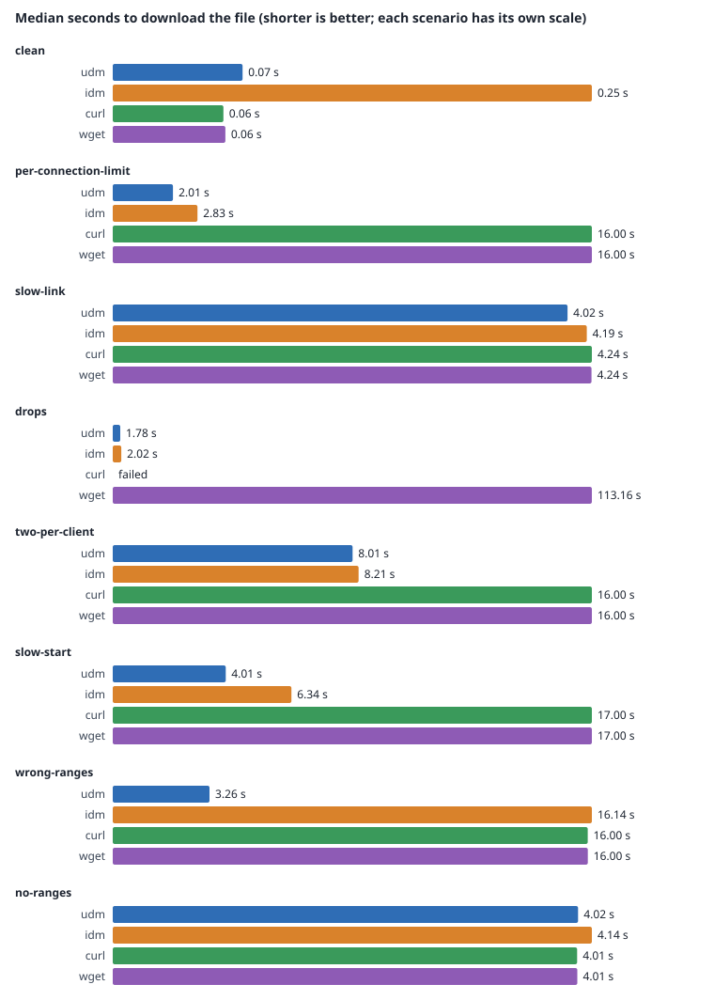

# Benchmark: UDM against IDM

> **One run against IDM so far**, on one Windows machine on 2026-11-12. See [Results](#results).
> It is one machine and one IDM version; more runs on other machines are welcome.



The harness downloads the same file several times with each download manager, from a local
server that can misbehave on purpose, and records how long each download took, how much CPU it
used and whether the file came out byte-identical. Every manager runs at its own default
settings.

- `tools/bench/bench.py`: the harness.
- `tools/bench/faultserver.py`: the server, also usable on its own.
- `docs/bench/results/`: one folder per run of the harness, with its raw data.

Both are Python 3.9 or later, standard library only, and run on Windows, macOS and Linux. They
are developer tools: they are not part of the quality gates and are not shipped in any package.

## What it measures

For each scenario, each tool downloads the file `--runs` times (5 by default), after one
unrecorded warm-up run (`--warmup`). The tools take turns, and a different one goes first in
each round. Each run gets a fresh, empty folder and an address of its own (`?run=<random>`), so
no tool takes it for a download it already has.

| Column in `runs.csv` | What it is |
|---|---|
| `seconds` | Wall time from starting the tool's command to having the whole file. For a tool that exits when it is done, until it exits. For IDM, until the whole file is in the folder and IDM has let go of it (checked every 20 ms) |
| `cpu_seconds` | User plus system CPU time during the run: the tool's own process; for UDM, `udm-cli` plus the daemon; for IDM, `IDMan.exe` plus the `/d` call |
| `bytes`, `ok` | The file's size, and whether it matched the server's SHA-256 |
| `exit_code`, `error` | What the tool returned, and why a run counts as failed |
| `server_*` | What the server saw: connections opened, requests, the most connections from the client at once, connections refused, and body bytes sent (more than the file means bytes sent twice, or sent and thrown away) |

`summary.md` gives the median, minimum and maximum of the runs that got the whole file, and
`chart.svg` draws the medians. `bench.py report FOLDER` makes both again from `runs.csv`.

## The server and the scenarios

`faultserver.py` serves one generated file (byte *i* is *i* mod 251, so a byte at the wrong
place changes the hash) on 127.0.0.1, with HTTP/1.1 keep-alive, ranges, an ETag and a
Last-Modified date. It can inject the same faults as the engine's test server
(`crates/infrastructure/src/engine/testserver.rs`), which the engine's own tests use:

| Fault | Option | |
|---|---|---|
| Dropped connections | `--drop-after SIZE` | Each response's connection is closed after that many bytes of its body |
| Connections per client | `--max-per-client N` | At most N connections from one address are answered at once; the others get 503 and are closed |
| Slow starts | `--slow-start SECONDS` | Every answer waits that long |
| Wrong ranges | `--shifted-ranges N`, `--ignored-ranges N` | The first N range requests that start past byte 0 get a range 1 KiB earlier; the next N get 200 and the whole file |
| Speed per connection | `--rate SIZE` | Each connection gets at most that many bytes a second |
| Speed in all | `--total-rate SIZE` | All connections together get at most that many bytes a second |
| No ranges | `--no-ranges` | Range requests get the whole file, as from a server that cannot resume |

The harness runs these scenarios (`bench.py list` shows them, `--scenarios` picks some):

| Scenario | The server |
|---|---|
| `clean` | Well-behaved and as fast as loopback goes. This mostly measures each tool's fixed costs and the Python server, not a network |
| `per-connection-limit` | Each connection held to 4 MiB/s, as many real servers do. Tools that open more connections finish sooner |
| `slow-link` | All connections together held to 16 MiB/s, like a slow line: more connections should not help |
| `drops` | Each connection dropped after 4 MiB; 8 MiB/s each. A tool must resume to finish |
| `two-per-client` | Two connections at once, 503 for the rest; 4 MiB/s each |
| `slow-start` | One second before every answer; 4 MiB/s each |
| `wrong-ranges` | Two range answers 1 KiB off and one with the whole file; 4 MiB/s each. A tool must not write those bytes |
| `no-ranges` | No range support; 16 MiB/s. One connection, no resume |

To run the server alone, for a tool the harness does not know or to watch one by hand:

```sh
python3 tools/bench/faultserver.py --size 256M --rate 4M --max-per-client 2
```

It prints the file's address, and its counters are at `/_bench/stats`. `--host` makes it listen
on another address, to test from another machine on a network you trust.

## The tools

| Name | What runs | Notes |
|---|---|---|
| `udm` | `udm-cli get -q -d FOLDER -n NAME URL` | A separate copy (`UDM_INSTANCE=bench`) with its own daemon, which the harness starts and stops. On Windows and Linux its settings and list go in a temporary folder; on macOS in `~/Library/Application Support/UDM-bench`. Default settings, except that completion notifications are off |
| `idm` | `IDMan.exe /d URL /p FOLDER /f NAME /n` | Windows only. IDM must be running before the run starts, so its start-up is not timed. Found through IDM's registry key, or `--idm PATH` |
| `aria2c` | `aria2c --quiet=true --dir=FOLDER --out=NAME URL` | Its defaults, which open one connection per server |
| `curl` | `curl --silent --show-error --fail --output PATH URL` | One connection, and it does not retry by default, so it fails `drops` |
| `wget` | `wget --quiet --output-document=PATH URL` | |

`--tool 'NAME=COMMAND'` adds any other program that downloads a file and exits; `{url}`,
`{folder}`, `{name}` and `{path}` in its command are filled in. `--udm-bin` points at the
folder with `udm-cli` and `udm-daemon`: `target/release` by default, or an installed copy
(`%LOCALAPPDATA%\Programs\UDM` on Windows).

## Running the IDM comparison (Windows)

1. Install Python 3.9 or later, and IDM. Build UDM with
   `cargo build --release -p udm-app --bin udm-cli --bin udm-daemon`, or use an
   installed copy with `--udm-bin`.
2. Leave IDM's options as a fresh install has them. Write down IDM's version and the number of
   connections its Options show. If IDM shows a dialog each time a download completes, turn that
   dialog off (one per run gets in the way) and say so in the note.
3. Start IDM. Close browsers and other programs that use the network or the disk, plug in a
   laptop, and keep the download folder and the system on the same kind of disk between runs
   you compare. Windows Defender scans new files; note whether its real-time protection was on.
4. Run, from the repository:

   ```bat
   py tools\bench\bench.py list
   py tools\bench\bench.py run --tools udm,idm,aria2c --runs 5 ^
     --note "IDM 6.xx build yy, defaults, 8 connections, completion dialog off; Defender on; NVMe SSD"
   ```

   A full run of all eight scenarios with a 64 MiB file takes about three minutes for a tool that
   opens several connections, and about eight for one that opens one. `--size` changes the file
   (`--size 256M`), and `--scenarios` and `--runs` shorten it.
5. Commit the new folder under `docs/bench/results/` (`runs.csv`, `machine.json`, `summary.md`
   and `chart.svg`, a few kilobytes), put its chart and a short reading of it in this README, and
   replace the note at the top.

On Linux and macOS the same command runs without `idm`; `aria2c`, `curl` and `wget` are optional.

## What to record about the machine

`machine.json` records, without host or user names: the system and its version, the CPU and its
logical cores, the RAM, Python's version, every tool's version (UDM's with the commit it was
built from, when it is this repository's build), the file's size and hash, the number of runs and
every scenario's faults. Put in `--note` what the harness cannot see: the disk (SSD or HDD, and
whether the download folder is on it), the power plan, antivirus scanning, IDM's settings and
anything else running at the time.

## Reading the results

- Every server is on loopback: there is no real network's latency or loss. The scenarios model
  how servers behave, not how a line between you and them behaves. `clean` is limited by the
  Python server and by each tool's fixed costs.
- The CPU time of a long-lived process (UDM's daemon, IDM) is all it did during the run,
  which includes anything else it was doing then.
- IDM's time includes up to 20 ms of polling and whatever IDM does before the finished file is in
  the folder; UDM's and the others' end when their command exits.
- A run that did not produce the whole, correct file counts as failed and is left out of the
  medians, and the table shows how many runs succeeded.

## Results

| Folder | Machine | Tools | What it is |
|---|---|---|---|
| [2026-11-12-windows-idm](results/2026-11-12-windows-idm/summary.md) | Windows 11, Ryzen 7 9800X3D, NVMe SSD | UDM, IDM 6.43 build 18, curl, wget | The first comparison with IDM |
| [2026-11-10-linux-pullbay-only](results/2026-11-10-linux-pullbay-only/summary.md) | Linux, Ryzen 7 9800X3D | UDM only | A sample run that checks the harness and the faults work end to end. Not a comparison |

### Windows, against IDM (2026-11-12)

64 MiB, five runs per tool and scenario after one warm-up, UDM's release build against IDM 6.43
build 18 at its defaults (8 connections) with its "Download complete" dialog turned off. Defender's
real-time protection was on. aria2c was not installed. Every run of every tool got a byte-identical
file, except curl in `drops`, which does not retry by default.

| Scenario | UDM | IDM | curl | wget |
|---|---|---|---|---|
| `clean` | 0.07 s | 0.25 s | 0.06 s | 0.06 s |
| `per-connection-limit` | 2.01 s | 2.83 s | 16.00 s | 16.00 s |
| `slow-link` | 4.02 s | 4.19 s | 4.24 s | 4.24 s |
| `drops` | 1.78 s | 2.02 s | failed | 113.16 s |
| `two-per-client` | 8.01 s | 8.21 s | 16.00 s | 16.00 s |
| `slow-start` | 4.01 s | 6.34 s | 17.00 s | 17.00 s |
| `wrong-ranges` | 3.26 s | 16.14 s | 16.00 s | 16.00 s |
| `no-ranges` | 4.02 s | 4.14 s | 4.01 s | 4.01 s |

What the numbers say:

- UDM's median is the shortest, or within 0.02 s of curl's and wget's, in every scenario. It is
  ahead of IDM in all eight.
- In `wrong-ranges` IDM took 16.1 s, as long as one 4 MiB/s connection needs for the whole file,
  like curl and wget; UDM took 3.3 s.
- In `slow-start` the server saw up to 14 of IDM's connections at once against UDM's 8, and IDM
  took 6.3 s to UDM's 4.0 s.
- Where the server is the limit (`slow-link`, `no-ranges`, `two-per-client`), every tool lands
  within a few tenths of a second of the limit.
- In each round the tools take turns, so UDM's first and last runs of a scenario came more than
  a minute after its previous one. Its background service had quit by then, as it does after a
  minute with nothing to do, and those runs include starting it again: about 0.36 s
  (`per-connection-limit` 2.37 s against 2.01 s).
- CPU time on Windows is counted in 15.6 ms ticks, so downloads that mostly wait on a slow server
  read as 0.00 s for UDM, curl and wget. IDM's 0.2 to 0.7 s includes its window, which was open.

The first attempt at this run found two problems, fixed before the numbers above. Some UDM runs
took 2.14 s longer than others with the same requests. Windows takes about two seconds to refuse a
connection to a port nothing listens on, and every UDM client waited that out before starting a
stopped service (the client's connection now gives up after 250 ms). The service also quit less
than a minute after short downloads, because a client that came and went between two of its
five-second looks did not count as activity.

### Linux sample (2026-11-10)

The sample (64 MiB, five runs each, release build of commit 7006e77) shows UDM at its
defaults against each scenario. Each run got a byte-identical file. The times follow the server's
limits: for example, `two-per-client` took 8.1 s, which is 64 MiB over two connections at 4 MiB/s
each, and the server never saw more than two at once. `per-connection-limit` took 2.1 s with 8
connections, against the 16 s one 4 MiB/s connection would take. It says nothing about IDM.

---

[← Back to the help pages](../README.md)
